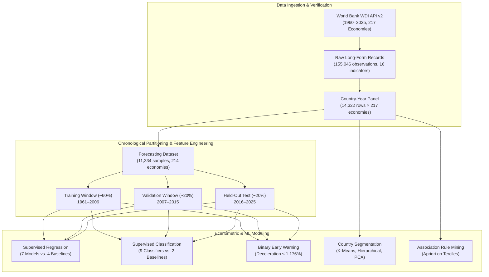

# GlobalPulse: Global Economic Development & Risk Intelligence

[](https://www.python.org/)
[](https://data.worldbank.org/)
[-brightgreen.svg)]()
[](https://scikit-learn.org/)
[]()

**GlobalPulse** is an econometric and machine learning benchmarking repository for cross-country macroeconomic growth forecasting, development profiling, and economic early-warning detection using longitudinal data from the **World Bank World Development Indicators (WDI) API v2**.

---

## 1. Project Overview & Research Objectives

Forecasting national real Gross Domestic Product (GDP) growth is central to fiscal planning, multilateral investment, and sovereign debt sustainability. However, macroeconomic time series are characterized by heavy-tailed shock distributions, structural breaks, cross-country heterogeneity, and low signal-to-noise ratios.

GlobalPulse answers three foundational empirical questions:
1. **Can complex machine learning algorithms reliably beat naive persistence and historical-mean baselines in forecasting one-year-ahead real GDP growth?**
2. **Do standard macroeconomic indicators provide actionable early-warning signal for growth deceleration and economic regime shifts?**
3. **Does cross-country clustering reveal sharp, discrete tiers of economic development, or a continuous developmental continuum?**

---

## 2. End-to-End Pipeline Architecture



---

## 3. Data Source & Longitudinal Panel

The repository dynamically ingests 16 key development indicators from the **World Bank WDI API v2** across the 1960–2025 observation window:

- **Economic Growth:** Annual real GDP growth (`NY.GDP.MKTP.KD.ZG`), GDP per capita growth (`NY.GDP.PCAP.KD.ZG`), Current GDP per capita (`NY.GDP.PCAP.CD`), Constant 2015 Real GDP per capita (`NY.GDP.PCAP.KD`).
- **Macroeconomic Stability:** CPI Inflation (`FP.CPI.TOTL.ZG`), Total Unemployment (`SL.UEM.TOTL.ZS`).
- **Trade & External Flows:** Exports % GDP (`NE.EXP.GNFS.ZS`), Imports % GDP (`NE.IMP.GNFS.ZS`), FDI Inflows % GDP (`BX.KLT.DINV.WD.GD.ZS`).
- **Demographics & Human Capital:** Total Population (`SP.POP.TOTL`), Urban Population % (`SP.URB.TOTL.IN.ZS`), Life Expectancy (`SP.DYN.LE00.IN`), Adult Literacy % (`SE.ADT.LITR.ZS`), Health Expenditure % GDP (`SH.XPD.CHEX.GD.ZS`).
- **Technology & Environment:** Internet Penetration % (`IT.NET.USER.ZS`), Carbon Dioxide Emissions per Capita (`EN.GHG.CO2.PC.CE.AR5`).

For comprehensive schema and ingestion details, see [`data/README.md`](data/README.md).

---

## 4. Methodology Highlights

### Strict Chronological Split
Random cross-validation on panel data leaks contemporaneous global macroeconomic shocks (e.g., the 1973 oil crisis, 2008 global financial crisis) across folds. GlobalPulse enforces a **forward-chaining chronological split**:
- **Training Set (~60%):** 1961–2006 (Fitted on historical growth regimes).
- **Validation Set (~20%):** 2007–2015 (Used strictly for hyperparameter tuning and model selection).
- **Held-Out Test Set (~20%):** 2016–2025 (Untouched final benchmark evaluation).
- **Pandemic Sensitivity:** Models are tested both on the full test window and with the 2020–2021 COVID-19 pandemic shock years removed.

### Lookahead Leakage Prevention
World Bank income categories (e.g., High Income, Low Income) are constructed retrospectively and reflect past economic growth. To eliminate hindsight leakage, these static labels are **strictly omitted** from predictive features. All imputations and scaling parameters are calculated exclusively on training partitions.

For deep algorithmic formulations and equations, refer to [`docs/methodology.md`](docs/methodology.md).

---

## 5. Summary of Empirical Findings

*All metrics are drawn from the completed execution run across 11,334 one-year-ahead forecasting samples.*

### A. Supervised Regression (Next-Year GDP Growth)
- **Validation-Selected Model:** **Huber Regression (robust M-estimator)** achieved lowest validation RMSE (5.315 pp).
- **Test Performance:** Test RMSE of **5.885 pp** and test MAE of **3.098 pp**, explaining only **3.37%** of next-year growth variance ($R^2 = 0.034$).
- **Baseline Comparison:** Huber outperforms the **Training Mean Baseline** (RMSE 6.095 pp) by **+0.211 pp** (a 3.5% error reduction).
- **Pandemic Impact:** Removing the 2020–2021 pandemic shock reduces Huber RMSE to **4.672 pp** (and baseline RMSE to 5.041 pp).

### B. Supervised Classification (3-Class Growth Regimes)
- **Validation-Selected Model:** **Gradient Boosting Classifier** selected with validation Macro-F1 of **0.5352**.
- **Test Performance:** Test Macro-F1 of **0.5499**, accuracy of **55.71%**, and multi-class OvR AUC of **0.7188**.
- **The Persistence Finding:** The simple **Previous-Year Category Baseline** outperforms all machine learning classifiers on both validation (0.5522) and test Macro-F1 (**0.5565** vs. 0.5499). Standard macro indicators offer no incremental edge over national growth momentum.

### C. Binary Early-Warning System (Growth Deceleration $\le 1.176\%$)
- **Logistic Regression:** Test AUC = **0.699**, Macro-F1 = **0.479**.
- **Random Forest:** Test AUC = **0.721**.
- **Insight:** Macro indicators carry meaningful statistical ranking capacity for deceleration risk, but high false-positive rates necessitate cautious threshold tuning before operational policy adoption.

### D. Unsupervised Country Profiling
- **Optimal K-Means ($k=2$):** Silhouette score of **0.2224** on the 2025 snapshot (192 countries), confirming that national economies reside on a continuous spectrum rather than in distinct, discrete clusters.
- **Profile H ($n=120$):** Median real GDP per capita **\$16,191**, median growth **2.36%**, urban share **74.4%**, life expectancy **77.9 years**.
- **Profile L ($n=72$):** Median real GDP per capita **\$1,587**, median growth **4.18%**, urban share **42.0%**, life expectancy **67.3 years**.
- **Hierarchical Clustering:** Average linkage achieved the highest cophenetic correlation (**0.754**).

For complete metrics and comparison tables, see [`docs/results_summary.md`](docs/results_summary.md).

---

## 6. Repository Structure

```text
GlobalPulse/
│
├── GlobalPulse_IEEE_Fresh.py      # Untouched, byte-exact Python source script
├── README.md                      # Comprehensive project documentation
├── requirements.txt               # Core dependencies verified on Python 3.12
├── requirements-optional.txt      # Optional mlxtend dependency for Apriori
├── .gitignore                     # Git rules protecting outputs, logs, and datasets
│
├── data/
│   └── README.md                  # WDI indicator dictionary and ingestion guide
│
└── docs/
    ├── methodology.md             # Theoretical framework, equations, and validation
    ├── results_summary.md         # Full empirical benchmark tables and findings
    │
    └── figures/
        ├── 01_data_overview.png           # 16-indicator temporal availability heatmap
        ├── 02_regression_results.png      # Validation vs. test RMSE regression scorecard
        ├── 03_classification_results.png  # Multi-class classification scorecard & confusion
        └── 04_country_clustering.png      # 2D PCA projection of country development profiles
```

---

## 7. Installation & Setup

### Prerequisites
- Python $\ge$ 3.10 (tested and verified on **Python 3.12.6**)
- Standard package manager (`pip` or `conda`)

### Option A: Standard Virtual Environment (Windows PowerShell / CMD)
```powershell
# 1. Clone or navigate to the GlobalPulse directory
cd GlobalPulse

# 2. Create a clean virtual environment
python -m venv .venv

# 3. Activate the environment
# Windows PowerShell:
.venv\Scripts\Activate.ps1
# Windows Command Prompt (CMD):
.venv\Scripts\activate.bat

# 4. Upgrade pip and install core dependencies
python -m pip install --upgrade pip
pip install -r requirements.txt

# 5. (Optional) Install mlxtend for Association Rule Mining
pip install -r requirements-optional.txt
```

### Option B: Conda Environment
```bash
# 1. Create a conda environment
conda create -n globalpulse python=3.12 -y

# 2. Activate the environment
conda activate globalpulse

# 3. Install core dependencies
pip install -r requirements.txt

# 4. (Optional) Install mlxtend
conda install -c conda-forge mlxtend -y
```

### Option C: Spyder IDE Setup
1. Launch **Spyder** and open `GlobalPulse_IEEE_Fresh.py`.
2. Configure Python interpreter:
   - Go to `Tools` $\to$ `Preferences` $\to$ `Python interpreter`.
   - Select `Use the following Python interpreter` and browse to your activated virtual environment (e.g. `GlobalPulse/.venv/Scripts/python.exe`).
3. Set Run Configuration:
   - Press `F6` (or `Run` $\to$ `Configuration per file`).
   - Under **Working directory**, select `The directory of the file being executed`.
   - Under **Console**, choose `Execute in a dedicated console` or `Execute in current console`.
4. Ensure the graphics backend is configured to inline or automatic (`Preferences` $\to$ `IPython console` $\to$ `Graphics`).

---

## 8. Reproduction & Execution Guide

### Standard Execution
To run the full pipeline:
```bash
python GlobalPulse_IEEE_Fresh.py
```

### Configuration Controls (Inside the Script)
- `OUTPUT_DIR`: By default, outputs are saved to the location specified by the `GLOBALPULSE_IEEE_DIR` environment variable, falling back to a dedicated local directory. To redirect outputs safely:
  ```powershell
  $env:GLOBALPULSE_IEEE_DIR = "C:\Path\To\My\Output"
  python GlobalPulse_IEEE_Fresh.py
  ```
- `FRESH_DOWNLOAD` (Boolean, default `True`): Initiates a fresh query of all 16 indicators from the World Bank API. Set to `False` to reuse an existing local cache inside `OUTPUT_DIR/data`.
- `STRICT_FRESH_DOWNLOAD` (Boolean, default `True`): Enforces that every indicator must be successfully downloaded without partial data loss.

> [!WARNING]
> Executing the script initiates a full live download of 65 years of World Bank WDI data across 217 economies, which requires an active Internet connection and takes approximately 2–3 minutes.

---

## 9. Limitations & Future Scope

1. **Unpredictable Macroeconomic Shocks:** Standard annual macroeconomic indicators cannot anticipate geopolitical conflict, commodity price spikes, or pandemics. Integrating high-frequency alternative data (satellite imagery, port throughput, nightlights) may enhance short-term forecasts.
2. **Missingness in Developing Economies:** Several critical indicators (e.g. adult literacy, health spending, informal labor) suffer from heavy historical missingness in lower-income countries, limiting feature availability prior to 2000.
3. **Linear Calibration in Classification:** Linear SVM and MLP utilize standard internal splits during probability calibration and early stopping. Future iterations could integrate strictly rolling, expanding-window walk-forward splits.

---

## 10. Data Attribution & License

- **Data Attribution:** World Development Indicators (WDI) provided by **The World Bank Group** under the [Creative Commons Attribution 4.0 International (CC-BY 4.0)](https://creativecommons.org/licenses/by/4.0/) license.
- **Source Code:** Educational and research use. The original Python source file is preserved byte-for-byte in this repository.

