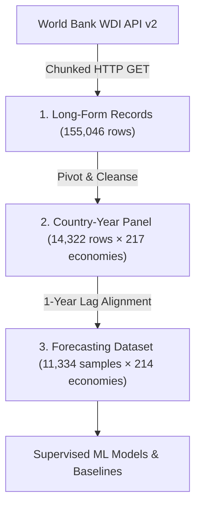

# GlobalPulse Data Acquisition & Pipeline Architecture

This directory documents the data ingestion protocols, schema definitions, and transformation pipeline used in **GlobalPulse**.

In accordance with open-source best practices and repository hygiene, raw datasets, cache files, and intermediate CSVs are **excluded from Git version control** (configured via `.gitignore`). This document explains how the dataset is generated dynamically and deterministically from primary sources.

---

## 1. Primary Data Source

All empirical data are acquired directly from the **World Bank World Development Indicators (WDI) API v2**.

- **API Endpoint:** `https://api.worldbank.org/v2`
- **Authentication:** Public open access (no API key required)
- **Format:** JSON (`format=json`)
- **License:** Creative Commons Attribution 4.0 International (CC-BY 4.0)
- **Requested Historical Range:** 1960–2025 (66 potential calendar years)
- **Geographic Coverage:** 217 recognized countries and autonomous economies

---

## 2. Tracked Indicators Dictionary

GlobalPulse extracts 16 standardized macro-development indicators spanning macroeconomic growth, monetary stability, international trade, demographics, education, and environmental impact:

| # | Indicator Key | World Bank Indicator Code | Description | Unit | Coverage Range | Observations |
|---|---------------|---------------------------|-------------|------|----------------|--------------|
| 1 | `GDP_GROWTH` | `NY.GDP.MKTP.KD.ZG` | Annual percentage growth rate of GDP at market prices | % | 1961–2025 | 11,408 |
| 2 | `GDP_PER_CAPITA_GROWTH` | `NY.GDP.PCAP.KD.ZG` | Annual percentage growth rate of GDP per capita | % | 1961–2025 | 11,408 |
| 3 | `GDP_PER_CAPITA_USD` | `NY.GDP.PCAP.CD` | GDP per capita in current United States dollars | Current US$ | 1960–2025 | 11,764 |
| 4 | `GDP_PER_CAPITA_REAL_USD` | `NY.GDP.PCAP.KD` | GDP per capita in constant 2015 United States dollars | Constant 2015 US$ | 1960–2025 | 11,533 |
| 5 | `POPULATION` | `SP.POP.TOTL` | Total midyear population count | Count | 1960–2025 | 14,292 |
| 6 | `URBAN_POP_PCT` | `SP.URB.TOTL.IN.ZS` | Urban population share of total national population | % | 1960–2025 | 14,322 |
| 7 | `INFLATION` | `FP.CPI.TOTL.ZG` | Consumer Price Index (CPI) annual percentage inflation | % | 1960–2025 | 9,151 |
| 8 | `UNEMPLOYMENT` | `SL.UEM.TOTL.ZS` | Total unemployment share of labor force (ILO modeled estimate) | % | 1991–2025 | 6,531 |
| 9 | `EXPORTS_PCT_GDP` | `NE.EXP.GNFS.ZS` | Exports of goods and services as a share of GDP | % | 1960–2025 | 9,029 |
| 10 | `IMPORTS_PCT_GDP` | `NE.IMP.GNFS.ZS` | Imports of goods and services as a share of GDP | % | 1960–2025 | 9,038 |
| 11 | `FDI_PCT_GDP` | `BX.KLT.DINV.WD.GD.ZS` | Foreign direct investment, net inflows as a share of GDP | % | 1970–2025 | 9,427 |
| 12 | `LIFE_EXPECTANCY` | `SP.DYN.LE00.IN` | Life expectancy at birth | Years | 1960–2024 | 14,071 |
| 13 | `INTERNET_USERS_PCT` | `IT.NET.USER.ZS` | Individuals using the Internet as a share of population | % | 1990–2025 | 6,224 |
| 14 | `LITERACY_PCT` | `SE.ADT.LITR.ZS` | Adult literacy rate (% of people ages 15 and above) | % | 1970–2024 | 1,121 |
| 15 | `HEALTH_EXP_PCT_GDP` | `SH.XPD.CHEX.GD.ZS` | Current health expenditure as a share of GDP | % | 2000–2024 | 4,562 |
| 16 | `CO2_PER_CAPITA` | `EN.GHG.CO2.PC.CE.AR5` | Carbon dioxide emissions per capita (excl. LULUCF) | Metric tons CO2e | 1970–2024 | 11,165 |

---

## 3. Ingestion & Verification Protocol

To ensure fault tolerance, server politeness, and complete reproducibility, data acquisition executes under the following strict network parameters:

- **Chunked Temporal Requests:** Queries are broken into 10-year windows (`YEAR_CHUNK_SIZE = 10`) to prevent API payload timeouts.
- **Batched Country Requests:** Sovereign economies are queried in batches of 25 ISO-3 codes (`COUNTRY_BATCH_SIZE = 25`).
- **Pagination:** Maximum allowable page size of 3,000 records per API call (`PER_PAGE = 3000`).
- **Exponential Backoff:** Up to 6 automatic retries per chunk (`MAX_RETRIES = 6`) with a 60-second connection timeout (`REQUEST_TIMEOUT = 60`).
- **Strict Verification Gate:** When `STRICT_FRESH_DOWNLOAD = True`, the ingestion engine validates that every indicator was retrieved without partial loss. If any indicator fails or drops data, execution halts immediately with an audit log.

---

## 4. Pipeline Stages & Derived Artifacts

When `GlobalPulse_IEEE_Fresh.py` runs, it builds the dataset through three successive transformations:

### Stage 1: Long-Form Ingestion (`world_bank_wdi_long.csv`)
- **Total records:** 155,046 indicator observations
- **Integrity verification:** Verified reference hash:
  `SHA-256: 5fcd164c2c7f798e9c733fd1eaa6130fbf0d2d22c817c4c1fa1862e73d5b4f8a`
- Contains individual country-year-indicator observation tuples directly from the API.

### Stage 2: Country-Year Panel (`globalpulse_country_year_panel.csv`)
- **Dimensions:** 14,322 rows across 217 sovereign economies (1960–2025)
- **Enrichment:** Merges ISO-3 country metadata, official country names, World Bank geographic regions, lending types, and income groups.
- Pivots indicators into columnar features.

### Stage 3: Supervised Forecasting Panel (`globalpulse_one_year_ahead_model_dataset.csv`)
- **Dimensions:** 11,334 country-year observations across 214 economies
- **Target Variable Definition:** For country $i$ at time $t$, the prediction target is strictly next-year GDP growth:
  $$y_{i,t+1} = \text{GDPGrowth}_{i,t+1}$$
- **Features:** Derived exclusively from observation year $t$ or earlier (including 1-year lags, 3-year rolling momentum, and regional binary indicators).
- **Leakage Prevention:** To avoid hindsight bias and lookahead leakage, static historical income-group classifications (e.g. High Income, Low Income) are **deliberately excluded** from predictive features, as they reflect cumulative past growth.

---

## 5. Provenance & Reproducibility Tracking

Every full execution generates a cryptographically stamped audit file in `OUTPUT_DIR/data/download_manifest.json` recording:
1. Exact timestamp and duration of API acquisition.
2. Status flag (`OK` or `PARTIAL`).
3. SHA-256 hash of the generated long-form CSV.
4. Per-indicator counts, temporal ranges, and observed country counts.
5. Exact package versions active during ingestion.

