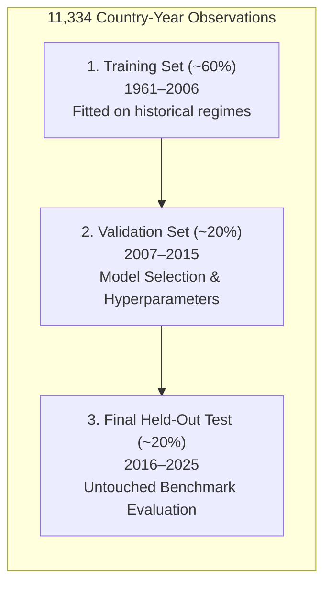

# GlobalPulse Methodology & Experimental Framework

This document details the econometric formulation, machine learning architectures, cross-validation protocol, and unsupervised methodologies implemented in **GlobalPulse**.

---

## 1. Problem Formulation & Empirical Scope

Macroeconomic growth forecasting is notoriously challenging due to exogenous global shocks, structural structural breaks, asymmetric cross-country economic heterogeneity, and high noise-to-signal ratios in reported national statistics.

GlobalPulse evaluates whether modern machine learning algorithms and regularized statistical methods can outperform simple temporal and historical baselines when predicting one-year-ahead national real GDP growth using longitudinal World Bank indicators.

### Panel Definition
- **Geographic Scope:** 217 countries and sovereign economies
- **Temporal Window:** 1960–2025 (66 observation years)
- **Supervised Forecasting Dataset:** 11,334 country-year observations from 214 economies
- **Target Variable Formulation:** For country $i$ in year $t$, the target is next-year real GDP growth:
  $$y_{i,t+1} = \text{GDPGrowth}_{i,t+1}$$
  All predictors $\mathbf{x}_{i,t}$ are restricted to information available in observation year $t$ or earlier.

---

## 2. Chronological Splitting & Leakage Prevention

In panel data settings, standard random shuffling or randomized $k$-fold cross-validation causes severe **lookahead leakage**, allowing models to memorize global temporal shocks (e.g. the 2008 Financial Crisis or commodity cycles) across countries.

GlobalPulse enforces a strict **forward chronological partition**:

1. **Training Partition (~60%):** Earliest sequential years (1961–2006) used exclusively for model fitting, feature scaling parameters, and imputation statistics.
2. **Validation Partition (~20%):** Middle chronological years (2007–2015) used exclusively for hyperparameter tuning and model selection.
3. **Held-Out Test Partition (~20%):** Final chronological years (2016–2025) reserved as an untouched test bed to report true generalization performance.
4. **COVID-19 Sensitivity Check:** The pandemic years (2020–2021) represented historic exogenous volatility. Test metrics are evaluated both across the full test set and separately with the pandemic shock years excluded (`RMSE_ex_COVID`).

### Feature Leakage Controls
- **Exclusion of Income Labels:** World Bank income group classifications (High income, Upper middle, Lower middle, Low income) are updated retrospectively and reflect historical growth. They are **strictly excluded** from predictive feature vectors to prevent lookahead bias.
- **Out-of-Fold Preprocessing:** Imputation medians and feature scaling transforms (`StandardScaler`, `RobustScaler`) are computed strictly on the training partition and transferred onto validation and test splits without refitting.

---

## 3. Supervised Regression Suite

To rigorously test whether complex ML captures genuine predictive signal, seven candidate models are pitted against four rigorous naive benchmarks.

### Baseline Models
1. **Training Mean Baseline:** Predicts the unconditional historical mean of GDP growth from the training period ($\hat{y}_{t+1} = \bar{y}_{\text{train}}$).
2. **Country Historical Mean Baseline:** Predicts each country's individual historical average growth up to year $t$.
3. **Persistence (Random Walk) Baseline:** Assumes growth in $t+1$ equals growth in year $t$ ($\hat{y}_{i,t+1} = y_{i,t}$).
4. **Zero-Growth Baseline:** Predicts 0.0% annual growth for all instances ($\hat{y}_{t+1} = 0$).

### Machine Learning & Econometric Models
1. **Huber Regressor (Robust M-Estimator):** Linear formulation with a hybrid loss function that transitions smoothly from squared loss for small errors ($|r| \le \delta$) to absolute loss for heavy-tailed outliers:
   $$L_\delta(r) = \begin{cases} \frac{1}{2} r^2 & \text{for } |r| \le \delta \\ \delta \left(|r| - \frac{1}{2}\delta\right) & \text{otherwise} \end{cases}$$
2. **Ridge Regression:** Linear regression with $L_2$ regularization penalty to prevent collinear instability.
3. **Random Forest Regressor:** Non-linear ensemble of 250 decision trees with subsample bagging.
4. **Gradient Boosting Regressor (Huber Loss):** Sequentially trained boosting trees optimizing a robust Huber objective.
5. **Multiple Linear Regression:** Classical least-squares regression across all engineered macro features.
6. **Polynomial Regression (Degree 2):** Second-order polynomial expansion capturing interaction terms.
7. **Simple Linear Regression:** Univariate regression using lagged GDP growth as the sole predictor.

---

## 4. Supervised Classification & Early-Warning Framework

### 3-Class Regime Forecasting
Target growth is categorized into three macro-development regimes:
- **Low Growth:** Growth below the lower tercile/quartile boundary.
- **Medium Growth:** Stable, baseline trend growth.
- **High Growth:** Growth in the upper tercile/quartile.

Nine classifiers are evaluated alongside two baselines:
- **Baselines:** Previous-Year Category Baseline and Majority-Class Baseline.
- **Classifiers:** Logistic Regression, Decision Tree Classifier, Linear SVM (with isotonic probability calibration), $k$-Nearest Neighbors ($k$-NN), Gaussian Naive Bayes, Multi-Layer Perceptron (MLP), Bagging Classifier, Gradient Boosting Classifier, and Random Forest Classifier.
- **Primary Metric:** Macro-Averaged F1-Score ($\text{Macro-F1}$), ensuring minority regimes (crises/booms) are weighted equally with the majority class.

### Binary Early-Warning System
Predicts whether a country will experience severe growth deceleration ($\text{Growth} \le 1.176\%$, corresponding to the lower quartile of training growth). Evaluated via ROC-AUC and Precision-Recall characteristics.

---

## 5. Unsupervised Country Profiling & Clustering

To examine cross-national structural similarity without relying on arbitrary administrative categories:

1. **Country Snapshot Construction:** Extracts 192 countries using the latest available indicator values within a 3-year retrospective window (2023–2025).
2. **Feature Suite (11 Indicators):** Real GDP per capita, GDP growth, urban population share, inflation, unemployment, life expectancy, Internet penetration, exports (% GDP), imports (% GDP), FDI inflows (% GDP), and $\text{CO}_2$ emissions per capita.
3. **K-Means Clustering:** Evaluated for $k \in [2, 8]$ using `k-means++` initialization. Model selection is governed by silhouette coefficients, with candidate solutions rejected if any cluster represents $<5\%$ of countries.
4. **Initialization Stability Audit:** 8 distinct random seed runs are evaluated via Adjusted Rand Index (ARI) to verify convergence consistency.
5. **Hierarchical Agglomerative Clustering:** Compared across Ward, Complete, Average, and Single linkage criteria using cophenetic correlation coefficients.
6. **Association Rule Mining (Apriori):** Indicators are discretized into terciles (`Low`, `Medium`, `High`) and combined with income group tags to mine association rules via support, confidence, and lift metrics.

---

## 6. Dimensionality Reduction & Regularization Analysis

- **Principal Component Analysis (PCA):** Determines intrinsic dimensional redundancy among WDI features. Analyzes eigenvalue scree decay and feature loading vectors.
- **Neural Network Regularization ($\alpha$ Sweep):** Explores weight decay parameters $\alpha \in [10^{-4}, 10^2]$ on an MLP architecture $(64, 32)$ to identify the optimal trade-off against noise.
- **Bias-Variance Decomposition:** Analyzes training and validation curves across decision tree depths ($d \in [2, 12]$) to isolate the overfitting horizon.
- **In-Sample Econometric Pre-Test (OLS):** Fits Ordinary Least Squares with country-clustered standard errors to assess conditional associations and multicollinearity (Variance Inflation Factor / Condition Number).

